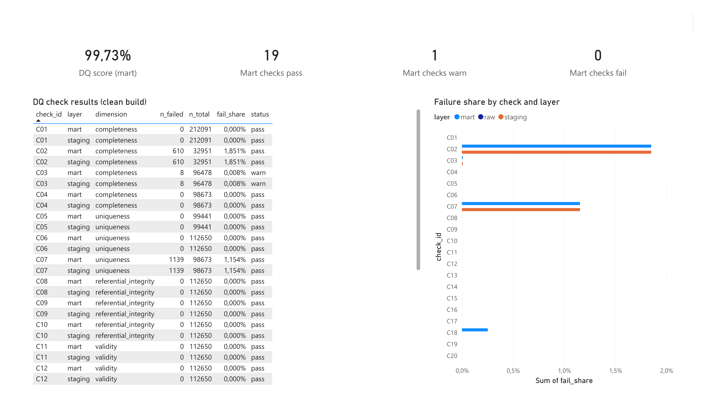

# olist-dq-kpi

**From Pipeline to Evidence: Data Quality in E-commerce Analytics.**
An analytics pipeline on the [Olist Brazilian e-commerce dataset](https://www.kaggle.com/datasets/olistbr/brazilian-ecommerce)
(Stage A) and a controlled experiment on how injected data errors distort business KPIs (Stage B).

## Reports and code versions

Each report was written against a fixed version of this repository. Check out the tag of the
report you are reading to get exactly the code and results it describes.

| Report | Covers | Tag | Branch |
|---|---|---|---|
| Pre-internship report, Part 2 | Stage A + Stage B + v1.1: pipeline, dashboard, error injection, RQ1–RQ4, drill, dbt, CI | `part2-report` | `master` |
| Advanced report | Everything in Part 2, plus RQ5 (learned KPI-risk score) and RQ6 (ML detectors M01–M03) | `advanced-report` | `ml-v1.2` |

```bash
git checkout part2-report          # or advanced-report
```

`v1.0-advanced` is the older tag cited in the first draft of the advanced report: Stage A and
Stage B only (RQ1–RQ3), before v1.1. It is kept so that citation still resolves.

## Status

**v1.0: Stage A and Stage B done (tag `v1.0-advanced`)** — pipeline, 15 KPIs, 20 DQ checks and
dashboard (Stage A); error injection E1–E6, main and robustness grids, Online Retail II replication,
RQ1–RQ3 statistics, tables and figures (Stage B). Every table and figure of the paper is rebuilt by
`python -m dqk.analysis.make_all`.

**v1.1 (on `master`)** adds, without changing any v1.0 number: KPI-aware checks
C21–C24 with thresholds calibrated on clean data, an extended experiment grid (RQ4, low error
rates), KPI-weighted DQ score variants, an incident drill, raw data contracts, a dbt project for
staging and mart, business analyses (cohorts, segments, Pareto, late-delivery what-if) and CI.
See [v1.1](#v11-extended-checks-drill-dbt-ci).



## Setup

Requires Python 3.12 and internet access to kaggle.com on the first run.

```bash
git clone https://github.com/lini1907/pre_internship.git olist-dq-kpi && cd olist-dq-kpi
python -m venv .venv
.venv\Scripts\activate              # Windows cmd / PowerShell
# source .venv/Scripts/activate     # Windows Git Bash
# source .venv/bin/activate         # macOS / Linux
pip install -r requirements.txt     # a few minutes: duckdb, pyarrow, pandas, scipy, matplotlib
pip install -e .
```

The dataset is public; no Kaggle API key is needed. It is downloaded on first use into
`data/raw/olist/`, and `data/raw/MANIFEST.json` records row counts and SHA-256 of each file.
Later runs stop with `ChecksumError` if the source files change.

## Run

```bash
python run_pipeline.py                       # download if missing -> raw -> DQ raw -> staging
                                             # -> DQ staging -> mart -> DQ mart -> KPI -> export
python run_pipeline.py --skip-download --no-export
```

The first run takes about 1.5 minutes including the download; later runs about 10 seconds
(measured on a laptop, 2026-11-08). Output:

- `warehouse/olist.duckdb` — schemas `raw`, `staging`, `mart`, `results`
- `results/stage_a/dq_results.csv`, `kpis_clean.csv`, `run_meta.json` (git commit, KPI spec hash, library versions)
- `exports/*.parquet`, `exports/*.csv` — mart tables, KPIs and DQ results for the dashboard (`docs/dashboard.md`)
- `docs/dq_catalogue.md` — check catalogue with the clean baseline

Exit code 1 if a check fails on the mart (`--allow-fail` to continue).

## Stage B: experiment

```bash
python run_experiment.py --grid config/grid_main.yaml --workers 8 --resume        # 65 cells x 200 seeds
python run_experiment.py --grid config/grid_robustness.yaml --workers 8 --resume  # 6 scenarios
python -m dqk.retail.adapter                                                      # Online Retail II mart
python run_experiment.py --grid config/grid_retail.yaml --workers 3 --resume      # 30 cells x 200 seeds
python -m dqk.analysis.make_all                                                   # all tables and figures
```

Each grid writes `results/runs/<grid>/<cell>.{kpi,dq,runs}.parquet` and `_meta.json` (git commit,
KPI spec hash, library versions). `--resume` skips finished cells; a pilot is
`--cell <cell_id> --seeds 5`. Measured wall time on a 12-thread laptop with 8 GB RAM: main grid
96 min (10 workers), robustness 2 h (10 workers), Online Retail II 67 min
(3 workers: each worker holds the 770k-line retail mart, 10 workers ran out of memory).
`make_all` takes a few minutes (`--n-boot 200` for a quick check) and writes:

- `results/tables/summary.md` — every result with its table; `paper_tables.md` — tables P1–P2 for the paper
- `results/tables/t*.csv` main grid, `r*.csv` robustness, `x*.csv` Online Retail II, `p*.csv` paper summary
- `results/figures/fig1`–`fig7` (PNG, 300 dpi, each with the CSV it is drawn from)

**Online Retail II** (UCI, CC BY 4.0) is loaded into the same mart schema as Olist (one invoice =
one delivered order, line revenue in `price`, StockCode in place of category, Country in place of
state), so the frozen KPI queries, DQ checks and injectors run unchanged. Which KPIs and checks apply,
and why the others do not: `src/dqk/retail/kpi_map.yaml`; cleaning rules with row counts:
`docs/retail_adapter.md`.

## v1.1: extended checks, drill, dbt, CI

```bash
python -m dqk.analysis.false_alarms --calibrate      # C23/C24 thresholds from clean split-halves
python run_pipeline.py --suite extended --accept     # core + C21-C24; store the reference snapshot
python run_experiment.py --grid config/grid_extended.yaml --only olist_ext --only olist_lowrate --workers 6 --resume
python run_experiment.py --grid config/grid_extended.yaml --only retail_ext --workers 3 --resume
python -m dqk.analysis.v11                           # t3c, t6*, t7, fig8-fig10, summary_v11.md
python -m dqk.drill                                  # results/drill/, docs/figures/drill_status.png
python -m dqk.insights                               # results/insights/, docs/figures/insight_*.png
python -m dqk.contracts                              # validate data/olist against contracts/*.yaml
```

**Extended checks (C21–C24, `config/dq_checks_extended.yaml`).** C21 customer key present (the
gap K9/K10 had in the traceability matrix); C22 product category unchanged vs the last accepted
snapshot; C23 category mix of order lines vs the reference (aggregates only); C24 log price within
median ± 5 MAD of its category. None is in the DQ score; the core suite (`--suite core`, default)
gives exactly the v1.0 results. Thresholds of C23/C24 were set from 200 clean split-half pairs
(warn = 99th percentile, fail = 2×) before any injection run; false alarms are in
`results/tables/f1_false_alarms.csv`. On clean month-vs-past comparisons C23 alarms in 19 of 20
months (real drift in the category mix), C24 in 7 of 20: aggregate drift checks are not usable
without a stable reference.

**Incident drill (`python -m dqk.drill`).** Four deterministic incidents: a week loaded twice
(C05, C06, C07, C18 fail), one seller's prices in centavos (C18 fail, C24 warn; GMV +99 %), 3 % of
one category re-mapped (only C22 reacts), and a renamed source column (stopped by the data contract
before staging).

**Data contracts (`contracts/*.yaml`, `src/dqk/contracts.py`).** Required columns, declared types
and the share of values that do not cast; `run_pipeline.py` stops on a violation. The YAML follows
the spirit of the Open Data Contract Standard but is not validated against it.

**dbt (`dbt/`, `docs/dbt.md`).** Staging and mart as dbt-duckdb models generated from `sql/`;
generic and singular dbt tests mirror C01–C18. Optional, in its own venv
(`requirements-dbt.txt`). The dbt mart equals the pipeline mart row for row
(`tests/test_dbt_parity.py`); lineage in `docs/figures/dbt_lineage.png`.

**CI (`.github/workflows/ci.yml`).** ruff, KPI spec lock, dbt models in sync, `pytest -m "not slow"`.

## Check that your build matches

A clean clone, set up as above, was tested on 2026-11-08: `python run_pipeline.py` exits 0,
`pytest` gives 60 passed, `python -m dqk.config check` prints "KPI spec matches lock", and
`results/stage_a/kpis_clean.csv` and `dq_results.csv` equal the reference build to 1e-9.
Quick check of your own build: mart DQ = 19 pass, 1 warn (C03), 0 fail; K1 GMV =
13,181,027.13 BRL; K2 delivered orders = 96,211 (more values in `docs/dashboard.md`).

## Dashboard

```bash
python -m dqk.powerbi          # writes powerbi/Olist.pbip with ExportsFolder = your exports folder
```

Open `powerbi/Olist.pbip` in Power BI Desktop (free) and press **Refresh**. Always run
`python -m dqk.powerbi` after cloning: the committed project points at the author's folder.
Screenshots of the five pages are in `docs/figures/dashboard_*.png` (PDF: `docs/figures/dashboard.pdf`).

## Other commands

| Command | Output |
|---|---|
| `python -m dqk.profiling` | `docs/profiling_report.md`, `docs/figures/*.png`, `results/stage_a/profiling.json` |
| `python -m dqk.config freeze` | `config/kpi_spec.lock` and `docs/kpi_spec.md` |
| `python -m dqk.config check` | exit 1 if `config/kpi_spec.yaml` or `sql/kpi/*.sql` changed since freeze |
| `python -m dqk.dq docs` | `docs/dq_catalogue.md` |
| `python -m dqk.powerbi` | `powerbi/Olist.pbip` — 5-page Power BI dashboard on `exports/` (`docs/dashboard.md`) |
| `python -m dqk.diagrams` | `docs/star_schema.png` |
| `python -m dqk.retail.adapter` | `warehouse/retail.duckdb`, `docs/retail_adapter.md` (downloads the UCI file on first run) |
| `python -m dqk.analysis.make_all` | `results/tables/*`, `results/figures/*` |
| `python -m dqk.analysis.false_alarms` | `results/tables/f1_false_alarms.csv` (v1.1) |
| `python -m dqk.analysis.v11` | v1.1 tables t3c, t6, t6b, t6c, t7 and figures 8-10 |
| `python -m dqk.drill` | `results/drill/`, `docs/figures/drill_status.png` (v1.1) |
| `python -m dqk.insights` | `results/insights/`, `docs/figures/insight_*.png` (v1.1) |
| `python -m dqk.contracts` | validates the raw files against `contracts/*.yaml` (v1.1) |
| `python dbt/sync_models.py` | regenerate `dbt/models/` from `sql/staging`, `sql/mart` (v1.1) |
| `pytest` | all tests; `pytest -m "not slow"` skips the reconciliation on real data |

## Layout

```
run_pipeline.py         Stage A in one command
run_experiment.py       Stage B: run a grid of error-injection cells
config/grid_*.yaml      main grid, robustness scenarios, Online Retail II grid
config/kpi_spec.yaml    15 KPIs, parameters and the 5 decisions fixed before Stage B
config/kpi_spec.lock    SHA-256 of the spec and every sql/kpi file
config/dq_checks.yaml   20 checks: dimension, layers, warn/fail thresholds, reference row counts
config/dq_checks_extended.yaml   C21-C24 (v1.1), parameters, calibrated thresholds
config/traceability.yaml         KPI -> guarding checks (Part 2, Table 3.7), for N2
contracts/              raw data contracts (v1.1)
dbt/                    dbt-duckdb project for staging and mart (v1.1, optional)
sql/analysis/           business analyses a01-a05 (v1.1)
config/category_translation_extra.csv   two category translations missing from the source
sql/staging/            one query per source table (casts, renames, one row per key)
sql/mart/               star schema: fact_orders, fact_order_items, dim_*
sql/kpi/                one query per KPI, returns (item, value, rank)
sql/dq/                 one query per check, returns (n_failed, n_total); {{table}} placeholders per layer
sql/retail/             Online Retail II staging and mart in the Olist schema
src/dqk/                io, db, tables, pipeline, kpis, dq, export, config, profiling, diagrams
src/dqk/inject/         E1-E6 injectors, unit sampling (MCAR / MAR / MNAR, nested rates)
src/dqk/experiment/     grid expansion, runner (parallel, resume), distortion and detection measures
src/dqk/analysis/       statistics (Friedman, Spearman + cluster bootstrap, Wilson), figures, make_all
src/dqk/retail/         Online Retail II adapter and kpi_map.yaml
docs/                   profiling report, KPI spec, DQ catalogue, cleaning log, dashboard spec, star schema
tests/                  KPI, DQ (planted errors), staging/mart rules, reconciliation against raw,
                        sampling, injectors, measures, Online Retail II adapter
```

## License

Code: MIT. Data outputs derived from Olist: CC BY-NC-SA 4.0, as the source data. Outputs derived
from Online Retail II (Chen, 2012, UCI Machine Learning Repository): CC BY 4.0.
