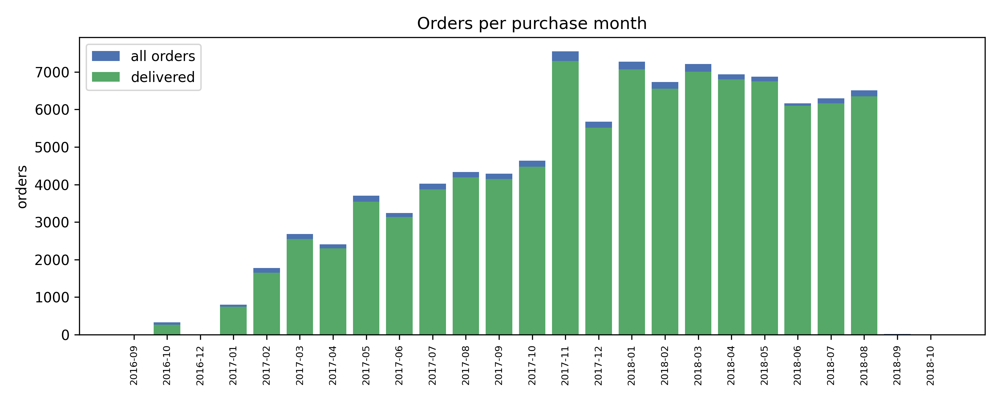
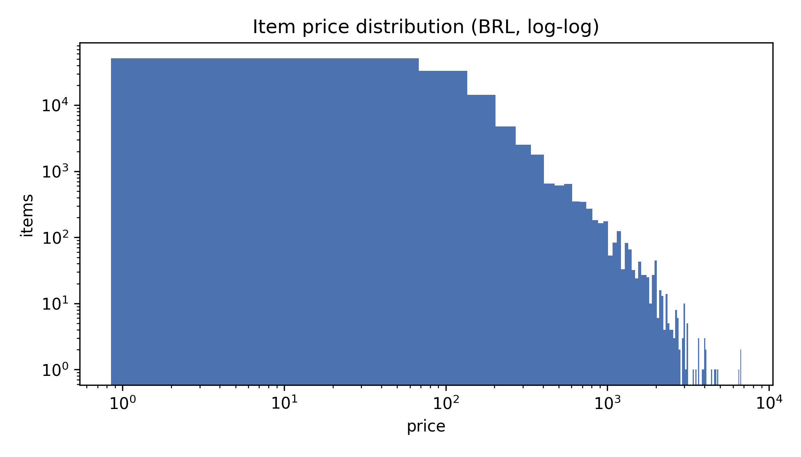
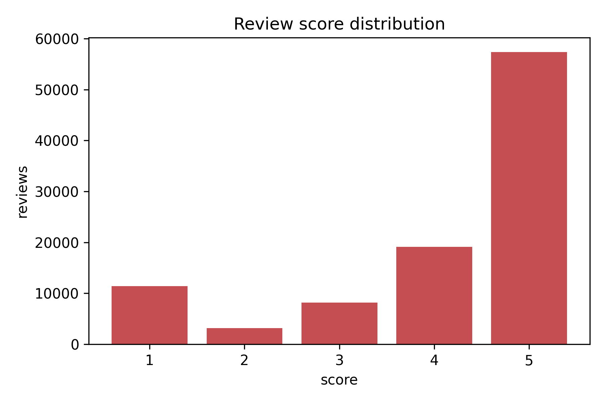

# Profiling report: Olist raw layer

Generated by `python -m dqk.profiling` on 2026-11-03. All numbers are computed from the raw CSV files (every column read as VARCHAR); nothing has been cleaned yet.

## 1. Tables

| table | rows | columns | sha256 (first 12) |
|---|---|---|---|
| orders | 99,441 | 8 | 8df58ef3d2d7 |
| order_items | 112,650 | 7 | 0bc4d068c4fe |
| order_payments | 103,886 | 5 | 4f713964f281 |
| order_reviews | 99,224 | 7 | 012b61c7593e |
| customers | 99,441 | 5 | 983a422239e1 |
| sellers | 3,095 | 4 | 1f643d2b9503 |
| products | 32,951 | 9 | 3e6569628a17 |
| product_category_name_translation | 71 | 2 | a81f0d1f27b2 |

## 2. Columns

`kind` is inferred: a column is numeric/timestamp only if every non-null value casts. Categorical columns (≤ 100 distinct values) show the top 5 values.

| table | column | kind | null_share | n_distinct | detail |
|---|---|---|---|---|---|
| orders | order_id | id/text | 0.00% | 99441 |  |
| orders | customer_id | id/text | 0.00% | 99441 |  |
| orders | order_status | categorical | 0.00% | 8 | delivered (97.0%), shipped (1.1%), canceled (0.6%), unavailable (0.6%), invoiced (0.3%) |
| orders | order_purchase_timestamp | timestamp | 0.00% | 98875 | 2016-09-04 – 2018-10-17 |
| orders | order_approved_at | timestamp | 0.16% | 90733 | 2016-09-15 – 2018-09-03 |
| orders | order_delivered_carrier_date | timestamp | 1.79% | 81018 | 2016-10-08 – 2018-09-11 |
| orders | order_delivered_customer_date | timestamp | 2.98% | 95664 | 2016-10-11 – 2018-10-17 |
| orders | order_estimated_delivery_date | timestamp | 0.00% | 459 | 2016-09-30 – 2018-11-12 |
| order_items | order_id | id/text | 0.00% | 98666 |  |
| order_items | order_item_id | numeric | 0.00% | 21 | 1 – 21 |
| order_items | product_id | id/text | 0.00% | 32951 |  |
| order_items | seller_id | id/text | 0.00% | 3095 |  |
| order_items | shipping_limit_date | timestamp | 0.00% | 93318 | 2016-09-19 – 2020-04-09 |
| order_items | price | numeric | 0.00% | 5968 | 0.85 – 6735 |
| order_items | freight_value | numeric | 0.00% | 6999 | 0 – 409.68 |
| order_payments | order_id | id/text | 0.00% | 99440 |  |
| order_payments | payment_sequential | numeric | 0.00% | 29 | 1 – 29 |
| order_payments | payment_type | categorical | 0.00% | 5 | credit_card (73.9%), boleto (19.0%), voucher (5.6%), debit_card (1.5%), not_defined (0.0%) |
| order_payments | payment_installments | numeric | 0.00% | 24 | 0 – 24 |
| order_payments | payment_value | numeric | 0.00% | 29077 | 0 – 13664.1 |
| order_reviews | review_id | id/text | 0.00% | 98410 |  |
| order_reviews | order_id | id/text | 0.00% | 98673 |  |
| order_reviews | review_score | numeric | 0.00% | 5 | 1 – 5 |
| order_reviews | review_comment_title | id/text | 88.34% | 4527 |  |
| order_reviews | review_comment_message | id/text | 58.70% | 36159 |  |
| order_reviews | review_creation_date | timestamp | 0.00% | 636 | 2016-10-02 – 2018-08-31 |
| order_reviews | review_answer_timestamp | timestamp | 0.00% | 98248 | 2016-10-07 – 2018-10-29 |
| customers | customer_id | id/text | 0.00% | 99441 |  |
| customers | customer_unique_id | id/text | 0.00% | 96096 |  |
| customers | customer_zip_code_prefix | numeric | 0.00% | 14994 | 1003 – 99990 |
| customers | customer_city | id/text | 0.00% | 4119 |  |
| customers | customer_state | categorical | 0.00% | 27 | SP (42.0%), RJ (12.9%), MG (11.7%), RS (5.5%), PR (5.1%) |
| sellers | seller_id | id/text | 0.00% | 3095 |  |
| sellers | seller_zip_code_prefix | numeric | 0.00% | 2246 | 1001 – 99730 |
| sellers | seller_city | id/text | 0.00% | 611 |  |
| sellers | seller_state | categorical | 0.00% | 23 | SP (59.7%), PR (11.3%), MG (7.9%), SC (6.1%), RJ (5.5%) |
| products | product_id | id/text | 0.00% | 32951 |  |
| products | product_category_name | categorical | 1.85% | 73 | cama_mesa_banho (9.2%), esporte_lazer (8.7%), moveis_decoracao (8.1%), beleza_saude (7.4%), utilidades_domesticas (7.1%) |
| products | product_name_lenght | numeric | 1.85% | 66 | 5 – 76 |
| products | product_description_lenght | numeric | 1.85% | 2960 | 4 – 3992 |
| products | product_photos_qty | numeric | 1.85% | 19 | 1 – 20 |
| products | product_weight_g | numeric | 0.01% | 2204 | 0 – 40425 |
| products | product_length_cm | numeric | 0.01% | 99 | 7 – 105 |
| products | product_height_cm | numeric | 0.01% | 102 | 2 – 105 |
| products | product_width_cm | numeric | 0.01% | 95 | 6 – 118 |
| product_category_name_translation | product_category_name | categorical | 0.00% | 71 | agro_industria_e_comercio (1.4%), alimentos (1.4%), alimentos_bebidas (1.4%), artes (1.4%), artes_e_artesanato (1.4%) |
| product_category_name_translation | product_category_name_english | categorical | 0.00% | 71 | agro_industry_and_commerce (1.4%), air_conditioning (1.4%), art (1.4%), arts_and_craftmanship (1.4%), audio (1.4%) |

## 3. Data issues (input to staging rules, code plan 3.2)

| check | description | count |
|---|---|---|
| review_id_duplicated | Review rows whose review_id appears more than once | 1,603 |
| review_id_distinct_dup | Distinct review_id values that are duplicated | 789 |
| orders_multi_review | Orders with more than one review | 547 |
| orders_without_review | Orders with no review row | 768 |
| review_score_invalid | Review rows with score not in 1..5 | 0 |
| products_no_category | Products with no category | 610 |
| categories_untranslated | Distinct categories missing from the translation table | 2 |
| delivered_no_delivery_date | Orders with status 'delivered' but no customer delivery date | 8 |
| not_delivered_with_delivery_date | Orders not 'delivered' that still have a customer delivery date | 6 |
| approved_before_purchase | Orders approved before purchase | 0 |
| carrier_before_approved | Orders handed to carrier before approval | 1,359 |
| delivered_before_carrier | Orders delivered to customer before handed to carrier | 23 |
| delivered_before_purchase | Orders delivered before purchase | 0 |
| payment_not_defined | Payment rows with payment_type = 'not_defined' | 3 |
| payment_zero | Payment rows with payment_value = 0 | 9 |
| orders_without_payment | Orders with no payment row | 1 |
| orders_without_items | Orders with no item row | 775 |
| delivered_without_items | Delivered orders with no item row | 0 |
| price_nonpositive | Item rows with price <= 0 | 0 |
| freight_zero | Item rows with freight_value = 0 | 383 |
| payment_mismatch_gt1 | Orders where |sum(payment) - sum(price + freight)| > 1 BRL | 249 |
| customer_unique_multi_state | customer_unique_id values seen in more than one state | 39 |
| item_orphan_product | Item rows whose product_id is not in products | 0 |
| item_orphan_seller | Item rows whose seller_id is not in sellers | 0 |

## 4. Orders per month

| year_month | orders | delivered |
|---|---|---|
| 2016-09 | 4 | 1 |
| 2016-10 | 324 | 265 |
| 2016-12 | 1 | 1 |
| 2017-01 | 800 | 750 |
| 2017-02 | 1780 | 1653 |
| 2017-03 | 2682 | 2546 |
| 2017-04 | 2404 | 2303 |
| 2017-05 | 3700 | 3546 |
| 2017-06 | 3245 | 3135 |
| 2017-07 | 4026 | 3872 |
| 2017-08 | 4331 | 4193 |
| 2017-09 | 4285 | 4150 |
| 2017-10 | 4631 | 4478 |
| 2017-11 | 7544 | 7289 |
| 2017-12 | 5673 | 5513 |
| 2018-01 | 7269 | 7069 |
| 2018-02 | 6728 | 6555 |
| 2018-03 | 7211 | 7003 |
| 2018-04 | 6939 | 6798 |
| 2018-05 | 6873 | 6749 |
| 2018-06 | 6167 | 6099 |
| 2018-07 | 6292 | 6159 |
| 2018-08 | 6512 | 6351 |
| 2018-09 | 16 | 0 |
| 2018-10 | 4 | 0 |

## 5. Distributions

## 6. Categories with enough reviews for K15

51 of 73 named categories have ≥ 100 reviewed orders (raw data, all months; the KPI applies the time window).
